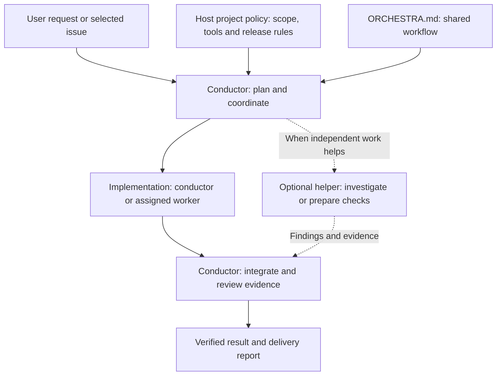
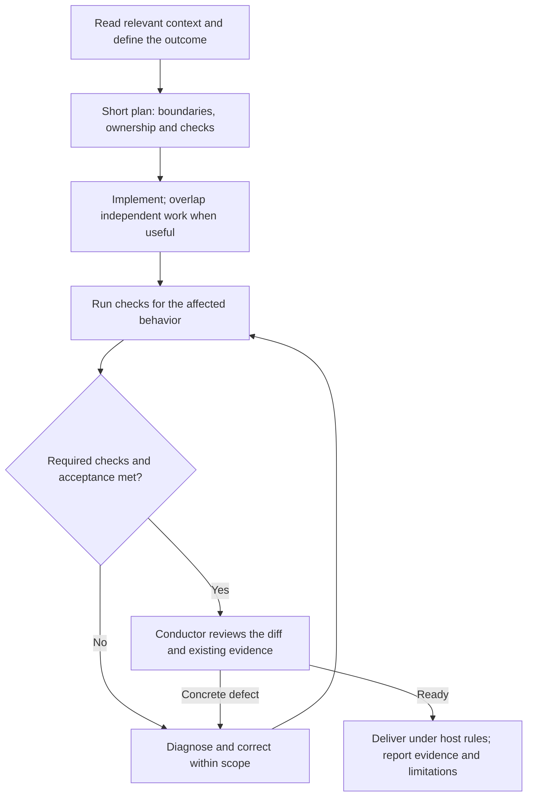

# Dirigenten och orkestern

Reusable instructions for an AI coding conductor and its workers. Plain Markdown,
independent of LLM provider, agent API, editor, language and package manager. The goal
is a shorter path to a verified result: deliberate resource use, brief planning,
useful parallelism, bounded checks and one review. This is an instruction package,
not an autonomous runtime.

Read [ORCHESTRA.md](ORCHESTRA.md) with a host project policy. Queue sessions also use
[COORDINATION.md](COORDINATION.md); assignments use [WORKER.md](WORKER.md). GitHub issue labels/state follow [Issueflow](ISSUE-WORKFLOW.md), maintained in
`solwation/github-dashboard`, rather than a separate orchestra-specific scheme. Start a
new integration from [PROJECT.example.md](PROJECT.example.md). A host may expose
`/orkester`, or ask any file-reading agent to follow these files directly. Tool syntax
and model names belong to the host/tool adapter; unavailable delegation falls back
to sequential roles without pretending to have workers.

## How it fits together

The **conductor** is the agent responsible for the whole delivery. It reads the host
project's rules and the shared workflow, chooses the smallest useful team, and owns
integration and review. The host provides the actual tools and permissions.



A small change can stay with one agent performing the roles in sequence. With workers,
each assignment has a clear scope and file ownership; one integration owner combines
the changes. Parallel work is useful only where the tasks are independent.

## From task to delivery



Unavailable evidence leaves the relevant acceptance open. Once the required checks
pass, review uses those results; extra test sweeps or review agents are not routine.
Publishing and deployment follow the host project's rules and authorization.

For an explicitly requested queue session, [COORDINATION.md](COORDINATION.md) adds
selection, ownership claims and polling around this delivery flow. Reading the package
does not start a queue session. [WORKER.md](WORKER.md) supplies the assignment brief;
[PROJECT.example.md](PROJECT.example.md) supplies the host policy template.

The diagrams use [Mermaid](https://docs.github.com/en/get-started/writing-on-github/working-with-advanced-formatting/creating-diagrams),
which GitHub renders directly in Markdown files and wikis. Their editable source lives
in this README.

## Install a pinned release

Recommended for this small documentation package: **Git subtree with squash**. Files
arrive in a normal clone, work offline, and updates are explicit reviewable commits.
Install into a clean working tree (requires Git's `subtree` command):

```sh
git subtree add --prefix=.orchestra/shared \
  https://github.com/solwation/dirigenten-och-orkestern.git v0.1.1 --squash
```

Copy the project example to `.orchestra/project.md`, fill it in, then link the host's
agent entry points to that policy and `.orchestra/shared/ORCHESTRA.md`. A slash command
is only a thin adapter: read host policy, read core, pass user scope. Do not copy the
core into a second prompt. Keep project configuration outside `.orchestra/shared`.

Record the release and resolved upstream commit in the host policy. The installed subtree never updates itself on agent startup; only the separately
maintained Issueflow guide is resolved once per session as described in ISSUE-WORKFLOW.md. To adopt a reviewed newer release, replace `<release>`:

```sh
git subtree pull --prefix=.orchestra/shared \
  https://github.com/solwation/dirigenten-och-orkestern.git <release> --squash
```

Review the imported diff, validate links and retained host rules, update the recorded
release/commit, and run applicable host checks. Preserve subtree merge ancestry and
`git-subtree-*` commit trailers. If unpublished integration commits must be rebased,
use `git rebase --rebase-merges origin/main`, or reapply the import on a fresh base.
An ordinary flattening rebase may lose the history used for later subtree updates.
To roll back, restore the last reviewed shared tree and host pin in a normal commit;
record why. Do not rewrite published history or move release tags.

## Improve it across projects

Make generic improvements in a **separate checkout of this repository**, review them
and publish a new release. Then explicitly update each consumer to that release.
This avoids long-lived project forks and exporting project content/history. Do not
run `git subtree push` from a consumer. A useful host-specific change can be proposed
here as a minimal generic patch; exclude private instructions, data and credentials.
Local-only policy stays local. Concurrent consumers can safely remain on older pins.

Use patch releases for compatible clarifications, minor releases for new optional
workflow, and major releases for incompatible policy contracts. Review behavior changes
regardless of version number. See [CHANGELOG.md](CHANGELOG.md). Contributions should
explain the concrete wasted work or missed quality gate and how the revised rule fixes
it. Validate instructions with a small scenario walkthrough, not keyword-count tests.

## Why this distribution

| Option | Trade-off |
| --- | --- |
| Subtree (chosen) | Ordinary files in every clone; explicit updates; modest duplication on disk |
| Submodule | Separate checkout and exact gitlink; requires initialization and checkout support |
| Remote instructions by URL | Convenient reference; network/tool access required, and floating URLs change behavior |
| Registry package | Useful for executable tooling later; adds installation/release machinery for a few text files |

Git documents [subtree merging](https://git-scm.com/book/en/v2/Git-Tools-Advanced-Merging#_subtree_merge)
and [submodule initialization](https://git-scm.com/docs/gitsubmodules). A pinned remote
URL or submodule is also valid when a project's environment supports it; neither is
required by the workflow. The consuming application needs no runtime dependency.

## Maintainer checks

Review diff, relative links and contradictions with the host policy. Exercise install
and update in a disposable Git repository when changing distribution instructions.
Walk through a small fix, an independent helper, a failed check, a claim race and an
idle fetch failure. For resource-policy changes also check an economical implementation,
a risky diagnosis, justified escalation and a runtime with locked model selection.
No browser or application benchmark is required for prose changes.
Do not claim measured speedups from the rules alone: use coarse real delivery timings
and regression/reopen outcomes for comparable work.

MIT licensed; see [LICENSE.md](LICENSE.md). The shared repository contains generic
instructions only, with no consumer application code or history.
